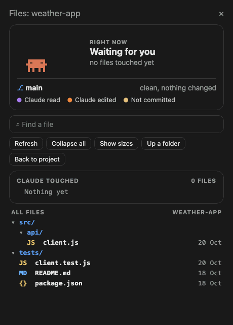

# claude-mods

Mods for [Claude Code](https://claude.com/claude-code): plugins that change Claude Code's own interface, such
as panes beside the chat that show what Claude and its subagents are doing. This repository is a plugin
marketplace, so each mod installs with one command.



## Mods

| Mod | What it does | Docs |
|---|---|---|
| **agents-panel** | An **Agents** pane that tracks every subagent: model, effort, tokens, estimated cost, time and progress, grouped by run, with an animated character per agent. | [README](mods/agents-panel/README.md) |
| **live-filetree** | A **Files** pane that shows what Claude is reading, editing and creating right now, with git status, a VS Code-style diff, and code and Markdown readers. | [README](mods/live-filetree/README.md) |

## Requirements

- Claude Code **2.1.287 or later** in the terminal (2.1.286 or later in the desktop app), the first versions
  that load mods.
- The panes draw in the **desktop app** (Code tab), the **terminal** and **VS Code**. What each surface
  animates is in each mod's README.

## Installation

Install a mod at the prompt of a Claude Code terminal session:

```
/plugin install live-filetree --marketplace corneflex/claude-mods
```

Answer `y` to add the marketplace, then choose a scope. The user scope loads the mod in every session, the
desktop app's included.

From a shell:

```bash
claude plugin install live-filetree --marketplace corneflex/claude-mods
```

In the desktop app, where `/plugin` is not available: click **+** next to the prompt box, choose **Plugins**,
then **Add marketplace** with `corneflex/claude-mods`, then **Add plugin**.

Replace `live-filetree` with `agents-panel` to install the other mod.

## Updating and removing

```bash
claude plugin update live-filetree@claude-mods
```

```bash
claude plugin uninstall live-filetree@claude-mods
```

A mod's options, where it has any, are listed in its README and set with `/plugin configure <mod>@claude-mods`
in a terminal session.

## Repository layout

```
.claude-plugin/marketplace.json   the marketplace: one entry per mod
mods/<mod>/                       one folder per mod (its plugin root)
  .claude-plugin/plugin.json      name, version, options
  hooks/                          the hooks module and the files it imports
  types/index.d.ts                the mod's state contract
  tests/                          tests run with `claude plugin test`
  README.md                       the mod's documentation
docs/screenshots/                 images used by the READMEs
```

## Contributing

See [CONTRIBUTING.md](CONTRIBUTING.md) for how to add a mod or change one.

## License

No licence has been chosen for this repository yet, so all rights are reserved by its author. Bundled
third-party code keeps its own licence; see each mod's README.
