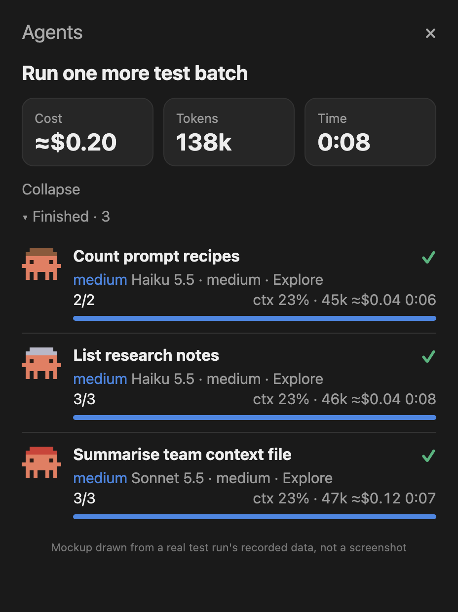
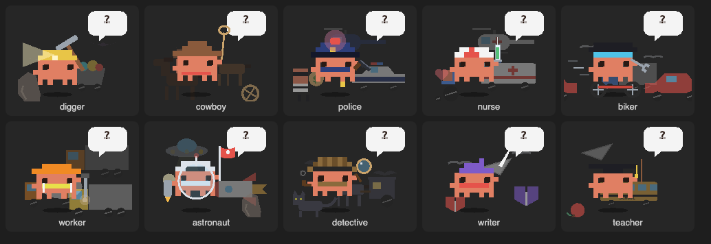
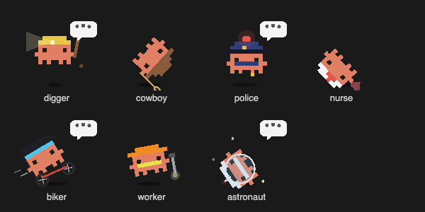
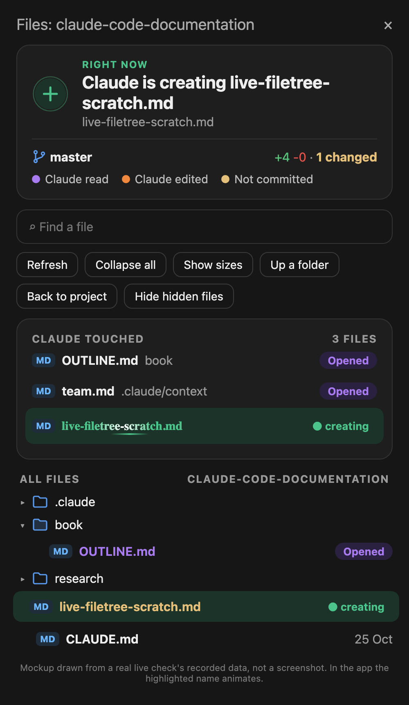

# claude-mods

Mods for [Claude Code](https://claude.com/claude-code): small plugins that change Claude Code's own
interface or behaviour. This repository is a plugin marketplace, so each mod installs with one line.

| Mod | What it does |
|---|---|
| [agents-panel](mods/agents-panel) | A live **Agents** pane beside the chat that tracks every subagent: model, effort, tokens, cost, time and progress, grouped by run. |
| [live-filetree](mods/live-filetree) | A live **Files** pane: what Claude is reading, editing and creating right now, highlighted and animated in the file tree, with git status and click-to-diff. |

## Install

At the prompt of a Claude Code terminal session:

```
/plugin install agents-panel --marketplace corneflex/claude-mods
/plugin install live-filetree --marketplace corneflex/claude-mods
```

Answer `y` to add the marketplace, then pick a scope (user scope loads it in every session).

From a shell:

```bash
claude plugin install agents-panel --marketplace corneflex/claude-mods
```

```bash
claude plugin install live-filetree --marketplace corneflex/claude-mods
```

In the desktop app, where `/plugin` does not run: click **+** next to the prompt box, then **Plugins**,
**Add marketplace** with `corneflex/claude-mods`, then **Add plugin**. A mod installed from a terminal at
the user scope also loads in the desktop app's Code tab.

---

## agents-panel



*Mockup drawn from the data recorded during a real test run of three subagents. A screenshot of the pane in
the app will replace it.*

When the Agent tool starts a subagent, the pane opens beside the chat and adds a row for it. Each batch of
agents launched from one prompt is a run with:

- **Title**: the prompt that launched it.
- **Totals**: Cost, Tokens and Time tiles, summed across the run's agents.
- **Groups**: `▾ Running · n` and `▾ Finished · n`, each collapsible, plus a **Collapse** toggle for the run.
- **One row per agent**:
  - a pixel-art critter avatar
  - the agent's description
  - a tag word for its effort level: `light` for low (green), `medium` (blue), `careful` for high (amber),
    `heavy` for xhigh/max (orange)
  - the model, effort and agent type
  - tool calls done
  - `ctx % · tokens ≈$cost m:ss`
  - a progress bar, and ✓ when done (✗ if it failed or was interrupted)

### Commands

| Command | Does |
|---|---|
| `/agents-panel` | Opens the pane. |
| `/agents-panel clear` | Forgets past runs. |

The mod also registers a read-only tool, `mcp__agents-panel__state`, which returns what the pane holds as
JSON so Claude can check the numbers.

### How the numbers are measured

| Shown | Source |
|---|---|
| Tokens, ctx % | The size of the agent's latest request, as Claude Code reports `subagent_tokens`. ctx % assumes a 200k context window. |
| Cost | An estimate from each request's token usage at list prices: Opus $5/$25, Sonnet $3/$15, Haiku $1/$5 per million input/output tokens; cache reads at 0.1× and cache writes at 1.25× the input price. Edit `PRICES` in `hooks/register.tsx` to change them. |
| Progress | Tool calls finished out of those started. The bar for a running agent advances with time, since its total is unknown, and fills when it ends. |
| Time | From the agent's start to its end (or now while running). |

In testing, tokens, tool counts and durations matched Claude Code's own completion reports to within about
100 tokens and 0.3 seconds.

### Sprites



*One frame of each character, rendered from the mod's own SVGs.*

Each agent in a run is a different character, and each one moves while its agent works:

| Character | Look | Motion |
|---|---|---|
| digger | miner's helmet with a lamp | lamp beam flickers, pickaxe swings, dirt flies |
| cowboy | wide-brim hat | lasso spins overhead, rides at a bounce, waves |
| police | cap and gold badge | red/blue siren flashes and glows, arm directs traffic |
| nurse | white cap with a red cross | sways side to side while hearts float up and fade |
| biker | helmet and visor | bounces on spinning wheels, speed lines stream past |
| worker | hard hat and hi-vis vest | jackhammer shakes the whole sprite, dust puffs |
| astronaut | helmet bubble and antenna | floats and drifts, antenna blinks, stars twinkle |

On top of its own move, every character performs two tricks in a 6-second loop:

| Character | Tricks |
|---|---|
| digger | jump, then dance |
| cowboy | double jump, then side shuffle |
| police | dance, then squat |
| nurse | side shuffle, then jump |
| biker | jump, then stomp |
| worker | stomp, then jump |
| astronaut | double jump, then squat |

The characters themselves never rotate or flip; only props such as the pickaxe and the bike's wheels turn.

They also blink and breathe, out of step with each other, and a shadow at their feet shrinks while they're
in the air. While an agent is waiting on the model, with no tool running, a thought bubble with bouncing
dots floats beside it.



*One frame 1.5 seconds into the loop, rendered from the mod's own SVGs.*

**Commit and push.** When an agent runs `git commit`, a green ✓ stamp pops above its sprite and confetti
falls. When it runs `git push`, an arrow rockets up. Each plays three times and then fades out.

When an agent finishes, its character stands still.

To customize them, use the plugin's settings: `/config` in a terminal, or `pluginConfigs` in
`~/.claude/settings.json`:

| Option | Default | What it does |
|---|---|---|
| `character` | `mixed` | `mixed` gives each agent in a run a different character; name one to dress every sprite the same. |
| `motion` | `true` | Animates the characters. The commit and push stamps play either way. |
| `bodyColor` | `#E07F63` | The critters' body colour (hex). A value that isn't hex is ignored. |
| `animateFinished` | `false` | Keeps characters moving after their agent finishes. |

### Surfaces

The pane draws on the desktop app (with the avatars and bars as SVG, animated) and in the terminal (text
bars, no animation).

---

## live-filetree



*Mockup drawn from the data recorded during a real live check (two reads, then a new file created and
edited). In the app the highlighted name animates. A screenshot of the pane will replace it.*

A **Files** pane that opens beside the chat in the desktop app (`/live-files` opens it anywhere).

**Status card.** What Claude is doing right now, then what it did when the turn ends:

| While working | When done |
|---|---|
| `Claude is thinking` (spinning ✳) | `Claude committed 2 files` + short commit hash |
| `Claude is reading 3 files` (purple) | `Claude edited 1 file` + path and `+1 -1` |
| `Claude is editing client.js` (orange) | `Claude created 1 file` |
| `Claude is creating notes.md` (green) | `Claude read 3 files` |

Below it are the branch and how far it's ahead (`main ↑1`), then `clean, nothing changed` or
`+A -D · N changed`. A legend shows the colours for Claude read, Claude edited and Not committed.

**Tools.**
- *Find a file* searches every tracked and untracked file.
- *Refresh*, *Collapse all* and *Show sizes / dates*.
- *Up a folder*, *Back to project* and *Hide / Show hidden files*.

**Claude touched.** Every file Claude read, edited, created or committed during the current prompt. Each one
shows a file-type icon, its folder, `+/-` line counts, and a coloured text badge with no background: `◉ Opened`, `✎ Edited`,
`✚ Created` or `✓ Committed`.

**All files.** The project tree, with folder and file-type icons, and each file's date or size.

**Icons.** In the terminal, files show Nerd Font Material Design glyphs (`nf-md-*`) coloured in the Atom
Material Icons palette: yellow for JavaScript, blue for TypeScript, cyan for React, and so on. This needs a
[Nerd Font](https://www.nerdfonts.com) as the terminal font. The desktop app's font has no Nerd glyphs,
so there it shows emoji instead (🟨 JS, 🔷 TS, 📝 Markdown, 🐍 Python…). The `icons` option (`/config`, or
`pluginConfigs` in `~/.claude/settings.json`) sets `auto` (default), `nerd` (always glyphs) or `emoji`.
- Folders open by themselves down to the file Claude is working on.
- Files and folders with uncommitted changes are yellow, with their git status code and `+/-` counts.

**Live highlight.** While Claude works on a file, its name in both lists lights up: purple for reading,
orange for editing, green for creating.
- A bright band sweeps along the file name letter by letter.
- A spinner turns beside the `reading` / `editing` / `creating` label.

The rows animate inside the pane's own drawing, so the tree no longer flickers while it updates.

**Diff screen.** Click any file to open a full-screen diff in the style of VS Code:
- **Header:** a *← Files* button (or `b`) that returns to the tree, the file's icon, name, folder and
  `+/-` counts.
- **Body:** line numbers in the gutter, removed lines on red and added lines on green, and blue hunk headers.
- **Layout:** *Side by side* (or `v`) puts HEAD on the left and the working tree on the right; *Inline*
  shows one column. Side by side is the default when the pane is wide.
- **Other files:** a new file shows as all-added lines, and a file with no changes opens in a
  syntax-highlighted view.

Git status refreshes every 5 seconds and after every edit, write or shell command. The mod also registers
a read-only tool, `mcp__live-filetree__state`, which returns what the pane holds as JSON. The row animations
run in the desktop app and the terminal; VS Code shows the same rows without animation. It has no
third-party dependencies.

---

## Adding a mod

Each mod lives in `mods/<name>/` with its own `.claude-plugin/plugin.json` and `hooks/`. List it in
`.claude-plugin/marketplace.json`:

```json
{ "name": "<name>", "source": "./mods/<name>", "description": "<one line>" }
```

Check it before pushing:

```bash
claude plugin validate mods/<name>
```
