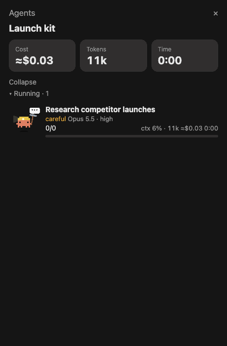
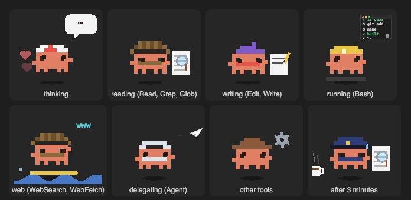

# agents-panel

An **Agents** pane beside the Claude Code chat that tracks every subagent the Agent tool starts: its model,
effort, tokens, estimated cost, time and progress, grouped by run. Each agent is drawn as an animated pixel
character.



*An 11-second demo: four agents run as one batch, one commits, one pushes, and they finish one by one.
Rebuilt from the mod's own sprite code and rendered frame by frame; the numbers come from a scripted
scenario, not a real run.*

- [Installation](#installation)
- [Usage](#usage)
- [Characters](#characters)
- [What the agent is doing](#what-the-agent-is-doing)
- [Configuration](#configuration)
- [How the numbers are measured](#how-the-numbers-are-measured)
- [Surfaces](#surfaces)
- [Limitations](#limitations)
- [Development](#development)
- [Version history](#version-history)
- [License](#license)

## Installation

```
/plugin install agents-panel --marketplace corneflex/claude-mods
```

Other ways to install, update and remove are in the [repository README](../../README.md#installation).

## Usage

The pane opens on its own when the Agent tool starts a new batch of subagents.

| Command | Does |
|---|---|
| `/agents-panel` | Opens the pane. |
| `/agents-panel clear` | Forgets past runs. |

Each batch of agents launched from one prompt is a **run**, titled with that prompt. A run shows:

- **Totals:** Cost, Tokens and Time tiles, summed across its agents.
- **Groups:** `▾ Running · n` and `▾ Finished · n`, each collapsible, and a **Collapse** toggle for the run.
- **One row per agent:**
  - its character and description;
  - a word for its effort level, `light` (low, green), `medium` (blue), `careful` (high, amber) or `heavy`
    (xhigh/max, orange), then its model, effort and agent type;
  - tool calls done, then `ctx % · tokens ≈$cost m:ss`;
  - a progress bar, and ✓ when it finishes (✗ if it failed or was interrupted).

## Characters


*One frame of each character, rendered from the mod's own SVGs.*

Each agent is drawn as the character that suits its role, read from its agent type and description (the
first match in this table wins):

| Role words | Character | Look and signature move |
|---|---|---|
| explore, research, search, web… | detective | deerstalker hat and coat; tiptoes, puffing smoke rings from a pipe |
| plan, architect, coordinate, design… | astronaut | helmet bubble and antenna; floats among twinkling stars |
| review, check, audit, verify, security… | police | cap and badge; siren flashes, arm directs traffic |
| test, QA, debug… | nurse | cap with a red cross; sways while hearts float up |
| write, doc, book, author… | writer | purple beret and red scarf; a quill bobs behind its ear |
| train, teach, tutor, guide, lab… | teacher | mortarboard with a swinging tassel; taps a pointer |
| setup, config, deploy, ops… | cowboy | wide-brim hat; spins a lasso, wrangling servers |
| fork, teammate, fast… | biker | helmet and visor; rides spinning wheels |
| build, refactor, fix, implement… | worker | hard hat and hi-vis vest; jackhammer and dust |
| dev, engineer, code, general… | digger | miner's helmet; swings a pickaxe, digging into code |

An agent whose role matches nothing gets a character picked from its type, the same one every time. The
`character` option can instead rotate through them or use one for every agent (see
[Configuration](#configuration)).

## What the agent is doing



The sprite acts out the tool the agent is using. An activity stays on screen for 4 seconds after its tool ends,
since most tool calls last milliseconds.

| The agent is… | Tool | The sprite |
|---|---|---|
| thinking | none (waiting on the model) | taps its chin under a thought bubble that goes `?`, `…`, then a lightbulb; does its two tricks |
| reading | Read, Grep, Glob | sweeps a magnifying glass across a page, eyes following; a "?!" pops up |
| writing | Edit, Write | scribbles lines with a pencil, tossing a crumpled draft over its shoulder |
| running | Bash | hammers a keyboard while a little terminal scrolls `$ npm test`, `✓ 12 pass`… and smokes |
| on the web | WebSearch, WebFetch | surfs a wave on a surfboard under a "www" sign |
| delegating | Agent | throws paper airplanes |
| using another tool | any other | fiddles with a turning gear |

| Event | The sprite |
|---|---|
| `git commit` | a green ✓ stamp and falling confetti, three times |
| `git push` | an arrow rocketing up, three times |
| running for over a minute | a sweat drop |
| running for over three minutes | a steaming coffee mug as well |
| finished | the character standing still |

When thinking, each character performs two tricks in a 6-second loop (jumps, double jumps, dances, shuffles,
squats or stomps). Every character blinks and breathes, out of step with the others, and casts a shadow that
shrinks while it is in the air. The characters never rotate or flip; only props such as the pickaxe, the gear
and the wheels turn.

## Configuration

Set options with `/plugin configure agents-panel@claude-mods` in a terminal session, or under `pluginConfigs`
in `~/.claude/settings.json`.

| Option | Default | Effect |
|---|---|---|
| `character` | `auto` | `auto` picks each agent's character from its role. `mixed` rotates through all ten within a run. A character's name (`digger`, `cowboy`, `police`, `nurse`, `biker`, `worker`, `astronaut`, `detective`, `writer`, `teacher`) uses it for every agent. |
| `motion` | `true` | Animates the characters. The commit and push stamps play either way. |
| `bodyColor` | `#E07F63` | Body colour, as hex. Any other value is ignored. |
| `animateFinished` | `false` | Keeps characters moving after their agent finishes. |

## How the numbers are measured

| Shown | Source |
|---|---|
| Tokens, ctx % | The size of the agent's latest request, as Claude Code reports `subagent_tokens`. ctx % assumes a 200k context window. |
| Cost | An estimate from each request's token usage at list prices: Opus $5/$25, Sonnet $3/$15, Haiku $1/$5 per million input/output tokens, with cache reads at 0.1× and cache writes at 1.25× the input price. Edit `PRICES` in `hooks/register.tsx` to change them. |
| Progress | Tool calls finished out of those started. A running agent's bar advances with time, since its total is unknown, and fills when it ends. |
| Time | From the agent's start to its end, or to now while it runs. |

In testing, tokens, tool counts and durations matched Claude Code's own completion reports to within about
100 tokens and 0.3 seconds.

## Surfaces

| Surface | Pane |
|---|---|
| Desktop app, VS Code | Full pane, with animated SVG characters and bars. |
| Terminal | Full pane, with a coloured marker for each agent and text bars; no animation. |

## Limitations

- Costs are estimates from list prices, not billing data.
- An agent keeps only its latest event: a push shortly after a commit replaces the commit stamp.
- Past runs stay in the pane until `/agents-panel clear`.

## Development

| Path | Contents |
|---|---|
| `hooks/register.tsx` | Hooks (agent spawn, model steps, tool calls, turn end), the pane, and the character SVGs. |
| `types/index.d.ts` | The state contract (`agents`, `runs`, `collapsed`, `now`); each agent keeps its last tool and when it used it. |
| `tests/pane.test.tsx` | Rows, totals, characters by role, activities from tool calls, the `character` option and the commit stamp. |

```bash
claude plugin validate mods/agents-panel
```

```bash
claude plugin test mods/agents-panel
```

The mod also registers a read-only tool, `mcp__agents-panel__state`, that returns what the pane holds as JSON.

## Version history

| Version | Changes |
|---|---|
| 0.5.0 | Characters chosen by the agent's role (three new: detective, writer, teacher); sprites act out the tool in use; sweat and coffee for long runs. |
| 0.4.2 | MIT licence. |
| 0.4.1 | Characters move only in straight lines: no spinning or flipping. |
| 0.4.0 | Two tricks per character, blinking, breathing, shadows and the thinking bubble. |
| 0.3.0 | Seven characters with props, and the commit and push stamps. |
| 0.2.0 | Animated sprites and the first options. |
| 0.1.0 | The Agents pane: runs, totals, rows and progress. |

## License

[MIT](LICENSE).
