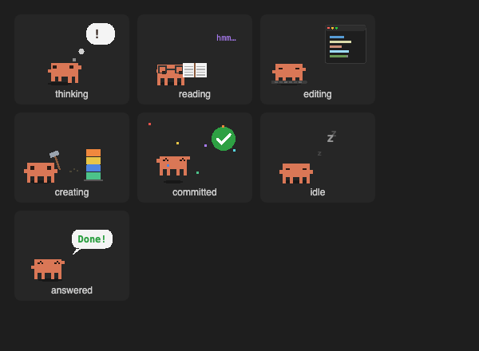

# live-filetree

A **Files** pane beside the Claude Code chat that shows what Claude is reading, editing and creating right now.
Files light up in the tree as Claude works on them, an animated pixel Claude acts out what it is doing, and a
click opens a VS Code-style diff, a code reader or a Markdown reader.


*A 10-second demo, rebuilt from the mod's own code and rendered frame by frame, not a screen recording.*

- [Installation](#installation)
- [Usage](#usage)
- [The pane](#the-pane)
- [Viewing a file](#viewing-a-file)
- [Surfaces](#surfaces)
- [Limitations](#limitations)
- [Development](#development)
- [Third-party code](#third-party-code)
- [Version history](#version-history)
- [License](#license)

## Installation

```
/plugin install live-filetree --marketplace corneflex/claude-mods
```

Other ways to install, update and remove are in the [repository README](../../README.md#installation). The mod
has no options.

## Usage

In the desktop app and VS Code the pane opens when a session starts. In the terminal, open it with:

| Command | Does |
|---|---|
| `/live-files` | Opens the Files pane. |

The pane follows the session's working directory and its git repository.

## The pane

### Status card

What Claude is doing right now, then what it did when the turn ends, acted out by an animated pixel Claude.



| State | The card says | Claude… |
|---|---|---|
| thinking | `Claude is thinking` | paces, glances around and taps its chin; its thought bubble goes `?`, `…`, `!`, then a lightbulb pings |
| reading | `Claude is reading 3 files` / `Claude read 3 files` | reads an open book through its glasses, eyes scanning each line, pages flipping |
| editing | `Claude is editing client.js` / `Claude edited 1 file` | types at a keyboard while code types itself into a small editor |
| creating | `Claude is creating notes.md` / `Claude created 1 file` | swings a hammer as blocks drop onto a stack |
| committed | `Claude committed 2 files` and the short hash | leaps under a ✓ stamp and falling confetti |
| idle | `Waiting for you` | dozes, with Z's drifting up |
| answered | `Claude answered` | waves beside a "Done!" speech bubble |

Below the scene are the branch and how far it is ahead (`main ↑1`), then `clean, nothing changed` or
`+A -D · N changed`, and a legend for the colours: Claude read, Claude edited, Not committed.

### Tools

| Control | Does |
|---|---|
| Find a file | Searches every tracked and untracked file, up to 60 matches. |
| Refresh | Reloads the open folders and git status. |
| Collapse all | Closes every folder. |
| Show sizes / Show dates | Switches the right-hand column. |
| Up a folder / Back to project | Moves the tree's root. |
| Hide / Show hidden files | Toggles dot-files. |

### Claude touched

Every file Claude read, edited, created or committed during the current prompt, with its file-type label
(`JS`, `TS`, `MD`, `PY`…), its folder, its `+/-` line counts and a badge: `◉ Opened`, `✎ Edited`,
`✚ Created` or `✓ Committed`. The list starts again with each prompt.

### All files

The project tree. Folders open by themselves down to the file Claude is working on. A file or folder with
uncommitted changes is yellow and shows its git status code and `+/-` counts; other files show their date or
size.

### Live highlight

While Claude works on a file, and for 8 seconds after (a read or an edit lasts only milliseconds), its name
lights up in both lists: purple for reading, orange for editing, green for creating. A bright band sweeps along
the name letter by letter, and a spinner turns beside the `reading`, `editing` or `creating` label. The rows
animate on their own, without redrawing the pane, so the tree does not flicker.

## Viewing a file

Click any file in the touched list, the tree or the search results.

| The file | Opens |
|---|---|
| has uncommitted changes | the **diff screen** |
| has no changes | the **code reader** |
| is Markdown with no changes | the **Markdown reader** |

The screen stays open until you leave it with **← Files** (`b`).

**Diff screen.** Line numbers in the gutter, removed lines on red, added lines on green, blue hunk headers,
and syntax colours in VS Code's Dark+ theme. Each hunk's old and new sides are highlighted as whole blocks,
so multi-line strings and comments colour correctly. **Side by side** (`v`) puts HEAD on the left and the
working tree on the right; **Inline** shows one column. Side by side is the default when the pane is wide.
A new file shows as all added lines.

**Code reader.** Line numbers and the same Dark+ colours, for about 25 languages: JavaScript, TypeScript,
JSX/TSX, JSON, Markdown, Python, shell, YAML, TOML, Rust, Go, Java, Kotlin, Swift, C, C++, C#, Ruby, PHP,
SQL, HTML/XML and CSS.

**Markdown reader.** The file rendered by Claude Code's own Markdown renderer, with headings, lists, tables,
code and links. **Source** (`p`) switches to the coloured source.

## Surfaces

| Surface | Pane |
|---|---|
| Desktop app | Full pane, with the animated Claude and animated rows. |
| Terminal | Full pane, with animated rows; the status card shows a marker instead of the scene. |
| VS Code | Full pane, with the animated Claude; the rows show the same information without animation. |

## Limitations

- The tree shows up to 400 rows; use Find a file beyond that.
- The diff screen shows up to 1,200 lines, and the code reader up to 1,000.
- Search and git status need the project to be a git repository.
- A deleted file stays in the touched list until the next prompt.
- Commits are detected from `git commit` commands that Claude runs through the shell.

## Development

| Path | Contents |
|---|---|
| `hooks/register.tsx` | Hooks (tool calls, turns, commits), git and folder loading, and the pane. |
| `hooks/rows.tsx` | The animated rows, drawn locally: shimmer, spinner and hover. |
| `hooks/claude.ts` | The animated Claude scenes for the status card. |
| `hooks/highlight.ts` | Syntax highlighting in VS Code's Dark+ colours. |
| `hooks/icons.ts` | File-type labels and colours. |
| `hooks/vendor/` | The bundled Prism (see below). |
| `types/index.d.ts` | The state contract. |
| `tests/pane.test.tsx` | Status card, touched list, tree, diff screen, readers and the VS Code fallback. |

```bash
claude plugin validate mods/live-filetree
```

```bash
claude plugin test mods/live-filetree
```

The mod also registers a read-only tool, `mcp__live-filetree__state`, that returns what the pane holds as JSON.

## Third-party code

Syntax highlighting uses [Prism](https://prismjs.com) 1.29.0, MIT licence, © 2012 Lea Verou. A mod cannot
install npm packages, so Prism's core and the language grammars above are bundled in
`hooks/vendor/prism.js`, with the licence in `hooks/vendor/PRISM-LICENSE`.

## Version history

| Version | Changes |
|---|---|
| 0.6.2 | MIT licence. |
| 0.6.1 | Files keep their highlight for 8 seconds after Claude's last action on them. |
| 0.6.0 | The animated Claude in the status card. |
| 0.5.1 | VS Code colours for control flow and template interpolations. |
| 0.5.0 | Syntax-coloured diff, code reader and Markdown reader, with Prism. |
| 0.4.1 | Back to coloured text file-type labels. |
| 0.4.0 | Nerd Font file icons (reverted in 0.4.1). |
| 0.3.0 | Text badges instead of coloured backgrounds. |
| 0.2.0 | Flicker-free animated rows and the full-screen diff. |
| 0.1.0 | The Files pane: status card, touched list, tree, git status and inline diffs. |

## License

[MIT](LICENSE). Prism, bundled in `hooks/vendor/`, is also MIT; see [Third-party code](#third-party-code).
